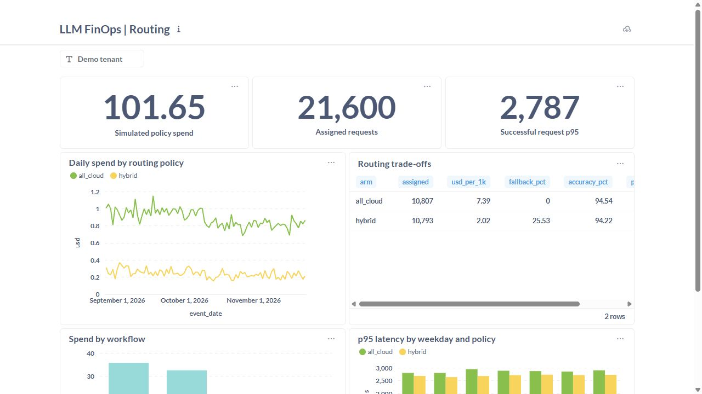
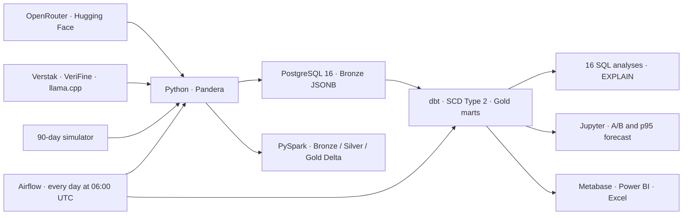

# LLM FinOps Warehouse

[Українська](README.uk.md)

Investigate LLM spend, request latency, model pricing changes, and routing experiments. The warehouse combines observed Verstak and VeriFine telemetry, live requests to an existing llama.cpp model, a 90-day randomized simulation, and public model catalogs.





## Run locally

Requires Docker with Compose, Python 3.11–3.13 through [uv](https://docs.astral.sh/uv/), and PowerShell for the bootstrap script. Run from the repository root.

```powershell
./scripts/demo.ps1
```

Add `-Offline` if the public data endpoints are unavailable, or `-WithAirflow` to start orchestration. Docker image and Python package downloads are needed the first time. The script prints the interactive Metabase URL with no sign-in for the synthetic report. The signed-in telemetry coverage dashboard is also created. See the [BI guide](bi/README.md) for credentials and export paths.

For Bash or selective execution, run the pipeline steps directly.

```bash
docker compose up -d --wait warehouse metabase
uv sync --locked --group analysis
uv run python -m ingestion.ingest_verstak_logs demo --end 2026-11-24
uv run python -m ingestion.fetch_open_models
uv run python -m ingestion.warehouse ingest
uv run dbt build --project-dir dbt_project --profiles-dir dbt_project
uv run python -m bi.metabase --public-demo
```

### Add live and historical telemetry

Run the launcher in a separate terminal. It starts the existing VeriFine Qwen GGUF on loopback with a 2,048-token context. Pass `-ModelPath` to use another existing model, `-LlamaRoot` for an alternate installation directory, or `-GpuLayers 0` for CPU. You can skip the launcher if an appropriate llama.cpp endpoint is already running.

```powershell
./scripts/start_verifine.ps1
```

Then run the import and capture commands from the repository root.

```powershell
uv run python -m ingestion.capture_llama --base-url http://127.0.0.1:9941 --model verifine-qwen-q4 --count 24
./scripts/export_verstak.ps1
uv run python -m ingestion.ingest_verstak_logs jsonl data/private/verstak.jsonl
uv run python -m ingestion.ingest_verstak_logs verifine ../verifine-slm/benchmarks/qwen-q4-llama-eval.json
uv run python -m ingestion.ingest_verstak_logs verifine ../verifine-slm/benchmarks/qwen-q4-llama-c4.json
uv run python -m ingestion.warehouse ingest
uv run dbt build --project-dir dbt_project --profiles-dir dbt_project
```

The exporter expects a running local Verstak PostgreSQL container. Use `-Container` when its name differs. The report importer accepts VeriFine request or prediction reports and an optional `--at` timestamp. See the [data contract](docs/data-contract.md).

### Orchestrate, analyze, and export

| Deliverable | Entry point |
| --- | --- |
| Airflow | `docker compose up -d --wait airflow-web airflow-scheduler`. Open [Airflow](http://127.0.0.1:8086), sign in with the local development credentials `admin` / `admin`, and unpause `llm_finops_daily` to enable the daily schedule. |
| Advanced SQL | [16 runnable SQL analyses](sql/queries/) and [measured execution plans](sql/optimization_report.md) |
| Databricks / Delta | [Three notebooks and execution guide](databricks/README.md) |
| Experiment and ML | [Jupyter notebook](notebooks/ab_routing_and_ml.ipynb) or `uv run --group analysis python -m analysis.routing` |
| Metabase and Power BI | [BI guide](bi/README.md), [Power BI dashboard](bi/llm_finops_dashboard.pbix), [editable Power BI project](bi/powerbi/LLM%20FinOps.pbip), and [DAX](bi/dax_measures.md) |
| CSV and Excel | `uv run --group analysis python -m bi.export` creates exports under `output/bi`. |
| GitHub Actions | [CI workflow](.github/workflows/ci.yml) runs Ruff, SQLFluff, dbt and pytest with PostgreSQL 16 and deterministic inputs. |

## Measured locally

| Check | Observed result |
| --- | --- |
| Event volume | 22,010 facts across PostgreSQL and local Delta for the same batch. 21,600 synthetic assignments, 348 VeriFine records, 38 Verstak workflow runs, and 24 live llama.cpp requests. |
| Public data collection | 461 OpenRouter model price observations and 1,200 Hugging Face benchmark values in the initial validation batch. |
| Local inference | 24/24 HTTP probes completed, with median end-to-end latency of 22.7 ms on the existing VeriFine Qwen GGUF. |
| Data quality | 56 dbt data tests passed on PostgreSQL, and all 16 SQL analyses executed. Replaying the same Bronze batch inserted zero rows. |
| Airflow | The scheduled and manually triggered runs both completed all five tasks, including fresh public-data extraction and dbt tests. |
| PostgreSQL benchmark | 1,121.521 ms heap median and 2.110 ms composite-index median on one million synthetic rows. The plans and limitations are documented. |
| Simulated routing | 72.67% lower mean scenario cost with a 95% bootstrap interval of 71.74% to 73.61%. Macro-F1 Δ was −0.19 pp with an interval of −0.84 to +0.48 pp. The lower bound cleared the −1.5 pp margin. SRM p was 0.924. |
| p95 forecasting | 302.44 ms MAE versus 297.64 ms for the last-observation baseline over the chronological holdout. The baseline performed better. |

The routing result belongs to the simulated traffic and price assumptions. The live inference smoke test and imported telemetry document real measurements for their respective sources. [Routing results](docs/results/routing-demo.json) · [Delta reconciliation](docs/results/delta.json)

## Sources and deployment scope

OpenRouter exposes the observed USD token rates. Hugging Face supplies an archive of Open LLM Leaderboard evaluations. Artificial Analysis is an optional authenticated, private raw export using `AA_API_KEY` and `--artificial-analysis`. Apply the provider's data rights before redistribution. [OpenRouter models](https://openrouter.ai/docs/api/api-reference/models/list-all-models-and-their-properties) · [Hugging Face archive](https://huggingface.co/datasets/open-llm-leaderboard/contents) · [Artificial Analysis terms and tiers](https://artificialanalysis.ai/data-api)

The Compose services bind to loopback for local use. The Metabase anonymous URL therefore works on this machine. Databricks execution in a cloud workspace and hosting an internet-accessible demo require accounts and deployment. The repository includes the notebooks and reproducible deployment steps.

## Verify

```powershell
uv run --locked ruff check .
uv run --locked sqlfluff lint sql dbt_project/models dbt_project/tests
$env:FINOPS_TEST_POSTGRES = '1'
$env:OMP_NUM_THREADS = '2'
uv run --locked --group analysis pytest -q
```

The PostgreSQL integrations expect the demo warehouse to have been built. To pause services and preserve local data, use `docker compose stop`.
