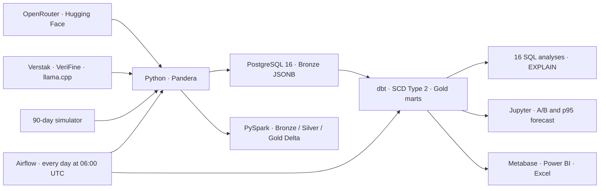

# LLM FinOps Warehouse

**An open-data lakehouse for LLM costs, inference latency, and routing experiments.**

[](https://github.com/Galactic717/llm-finops-dw/actions/workflows/ci.yml)

[Українська](README.uk.md) · [Quickstart](#quickstart) · [Measured results](#measured-results) · [SQL showcase](sql/queries/) · [Downloads](https://github.com/Galactic717/llm-finops-dw/releases/latest)

Find which workflows drive inference spend, trace each request to the tariff effective at the time, and measure the trade-offs of hybrid routing. The warehouse combines public model catalogs, a randomized 90-day simulation, and observed inference telemetry. [Verstak](https://github.com/Galactic717/verstak-agent) · [VeriFine](https://github.com/Galactic717/verifine-slm)

| Warehouse validation | PostgreSQL benchmark | Routing simulation |
| --- | --- | --- |
| **22,010** facts in local Delta | **1,122 ms → 2.11 ms** on one million rows | **72.67%** lower mean modeled cost |
| [Source counts](docs/results/delta.json) | [Query, plans, and test conditions](sql/optimization_report.md) | [Quality, SRM, and confidence intervals](docs/results/routing-demo.json) |


## Quickstart

Install Docker with Compose and [uv](https://docs.astral.sh/uv/). Clone and start the reference experiment from PowerShell.

```powershell
git clone https://github.com/Galactic717/llm-finops-dw.git
cd llm-finops-dw
./scripts/demo.ps1 -Offline
```

The script builds 90 days of deterministic synthetic data and prints the local Metabase link. Drop `-Offline` to fetch market data and benchmark scores. Add `-WithAirflow` to start the scheduler. Docker images and Python packages are downloaded on first use. [BI guide](bi/README.md)

<details>
<summary>Run the warehouse from Bash</summary>

```bash
git clone https://github.com/Galactic717/llm-finops-dw.git
cd llm-finops-dw
docker compose up -d --wait warehouse metabase
uv sync --locked --group analysis
uv run --locked --no-sync python -m ingestion.ingest_verstak_logs demo
uv run --locked --no-sync python -m ingestion.warehouse ingest
uv run --locked --no-sync dbt build --project-dir dbt_project --profiles-dir dbt_project
uv run --locked --no-sync python -m bi.metabase --public-demo
```

</details>

## Architecture



Bronze preserves source observations. Silver validates and deduplicates telemetry, derives tariff intervals, and prices requests using the rate effective at event time. Gold keeps the event's cost basis and provenance available to reporting. [Data contract](docs/data-contract.md)

<details>
<summary>Add live and historical telemetry</summary>


Run the launcher in a separate terminal. It starts the existing VeriFine Qwen GGUF on loopback with a 2,048-token context. Pass `-ModelPath` to use another existing model, `-LlamaRoot` for an alternate installation directory, or `-GpuLayers 0` for CPU. You can skip the launcher if an appropriate llama.cpp endpoint is already running.

```powershell
./scripts/start_verifine.ps1
```

Then run the import and capture commands from the repository root.

```powershell
uv run python -m ingestion.capture_llama --base-url http://127.0.0.1:9941 --model verifine-qwen-q4 --count 24
./scripts/export_verstak.ps1
uv run python -m ingestion.ingest_verstak_logs jsonl data/private/verstak.jsonl
uv run python -m ingestion.ingest_verstak_logs verifine ../verifine-slm/benchmarks/qwen-q4-llama-eval.json
uv run python -m ingestion.ingest_verstak_logs verifine ../verifine-slm/benchmarks/qwen-q4-llama-c4.json
uv run python -m ingestion.warehouse ingest
uv run dbt build --project-dir dbt_project --profiles-dir dbt_project
```

The exporter expects a running local Verstak PostgreSQL container. Use `-Container` when its name differs. The report importer accepts VeriFine request or prediction reports and an optional `--at` timestamp. See the [data contract](docs/data-contract.md).

</details>

## Measured results

| Check | Observed result |
| --- | --- |
| Event volume | Local Delta processed 22,010 facts: 21,600 synthetic assignments, 348 Verifine records, 38 Verstak workflow runs, and 24 live llama.cpp requests. |
| Public data collection | 461 OpenRouter model price observations and 1,200 Hugging Face benchmark values in the initial validation batch. |
| Local inference | 24/24 HTTP probes completed, with median end-to-end latency of 22.7 ms on the existing VeriFine Qwen GGUF. |
| Data quality | 56 dbt data tests passed on PostgreSQL, and all 16 SQL analyses executed. Replaying the same Bronze batch inserted zero rows. |
| Airflow | The saved acceptance run shows all five tasks succeeding, including public-data extraction and dbt tests. |
| PostgreSQL benchmark | 1,121.521 ms heap median and 2.110 ms composite-index median on one million synthetic rows. The plans and limitations are documented. |
| Simulated routing | 72.67% lower mean scenario cost with a 95% bootstrap interval of 71.74% to 73.61%. Macro-F1 Δ was −0.19 pp with an interval of −0.84 to +0.48 pp. The lower bound cleared the −1.5 pp margin. SRM p was 0.924. |
| p95 forecasting | 302.44 ms MAE versus 297.64 ms for the last-observation baseline over the chronological holdout. The baseline performed better. |

The simulator sets tariffs and classification accuracy and uses the true class to generate fallback rates. The live inference smoke test and imported telemetry document real measurements for their respective sources. [Routing results](docs/results/routing-demo.json) · [Delta fact counts](docs/results/delta.json)

## Explore the project

| Area | Start here |
| --- | --- |
| SQL and warehouse | [16 SQL analyses](sql/queries/) · [EXPLAIN plans](sql/plans/) · [dbt marts](dbt_project/models/marts/) |
| A/B and p95 forecast | [Jupyter notebook](notebooks/ab_routing_and_ml.ipynb) · [Executed report download](https://github.com/Galactic717/llm-finops-dw/releases/latest) |
| BI and exports | [Metabase and Power BI screenshots](bi/README.md) · [Power BI file](bi/llm_finops_dashboard.pbix) · [Editable Power BI project](bi/powerbi/LLM%20FinOps.pbip) · [DAX](bi/dax_measures.md) |
| Orchestration | [Airflow DAG](airflow/dags/llm_finops_daily.py) · [Local operations](docs/runbook.md) |
| PySpark and Databricks | [Bronze, Silver, and Gold notebooks](databricks/README.md) · [Local execution evidence](docs/results/) |
| Continuous integration | [GitHub Actions runs](https://github.com/Galactic717/llm-finops-dw/actions/workflows/ci.yml) · [CI configuration](.github/workflows/ci.yml) |

## Sources and deployment scope

OpenRouter exposes the observed USD token rates. Hugging Face supplies an archive of Open LLM Leaderboard evaluations. Artificial Analysis is an optional authenticated, private raw export using `AA_API_KEY` and `--artificial-analysis`. Apply the provider's data rights before redistribution. [OpenRouter models](https://openrouter.ai/docs/api/api-reference/models/list-all-models-and-their-properties) · [Hugging Face archive](https://huggingface.co/datasets/open-llm-leaderboard/contents) · [Artificial Analysis terms and tiers](https://artificialanalysis.ai/data-api)

The Compose services bind to loopback for local use. The Metabase anonymous URL therefore works on this machine. Databricks execution in a cloud workspace and hosting an internet-accessible demo require accounts and deployment. The repository includes the notebooks and reproducible deployment steps.

## Verify

```powershell
uv run --locked ruff check .
uv run --locked sqlfluff lint sql dbt_project/models dbt_project/tests
$env:FINOPS_TEST_POSTGRES = '1'
$env:OMP_NUM_THREADS = '2'
uv run --locked --group analysis pytest -q
```

The PostgreSQL integrations expect the demo warehouse to have been built. To pause services and preserve local data, use `docker compose stop`.
