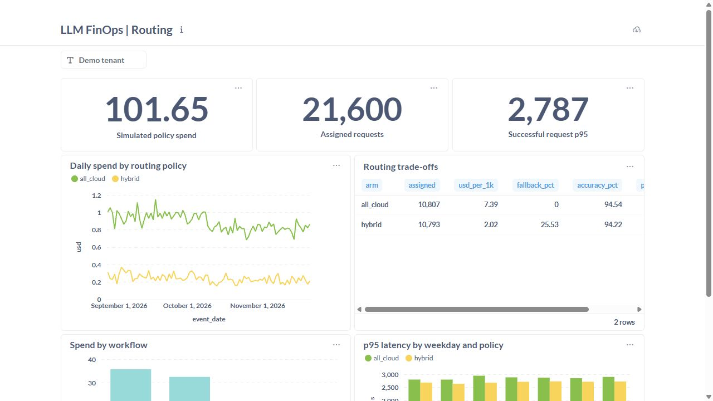

# LLM FinOps Warehouse

**Lakehouse для аналізу витрат, латентності й експериментів із роутингом LLM.**

[](https://github.com/Galactic717/llm-finops-dw/actions/workflows/ci.yml)

[English](README.md) · [Запуск](#запуск) · [Результати](#результати-перевірки) · [SQL-запити](sql/queries/) · [Завантаження звітів](https://github.com/Galactic717/llm-finops-dw/releases/latest)

Проєкт аналізує витрати на LLM, час відповіді, зміни тарифів та експерименти з роутингом. Він поєднує телеметрію Verstak і VeriFine, запити до наявної моделі через llama.cpp, 90 днів синтетичного трафіку та відкриті каталоги моделей.

| Перевірено у сховищі | Бенчмарк PostgreSQL | Симуляція роутингу |
| --- | --- | --- |
| **22 010** звірених фактів | **1 122 мс → 2,11 мс** на мільйоні рядків | **72,67%** економії за моделлю витрат |
| [Звірка PostgreSQL і Delta](docs/results/delta.json) | [Методика та плани запиту](sql/optimization_report.md) | [Якість, SRM та інтервали](docs/results/routing-demo.json) |



## Запуск

Потрібні Docker з Compose, [uv](https://docs.astral.sh/uv/) та PowerShell. Запустіть із кореня репозиторію.

```powershell
git clone https://github.com/Galactic717/llm-finops-dw.git
cd llm-finops-dw
./scripts/demo.ps1 -Offline
```

Параметр `-Offline` пропускає запити до відкритих API. Параметр `-WithAirflow` також запускає Airflow. Сценарій друкує локальне посилання на інтерактивний дашборд синтетичного експерименту, доступний без входу. У [посібнику BI](bi/README.md) є інструкції до звіту з телеметрією та експорту в Excel і Power BI.

## Наявна локальна модель

`scripts/start_verifine.ps1` запускає GGUF із сусіднього репозиторію `verifine-slm` через ваш `llama-server.exe`. Параметр `-ModelPath` приймає шлях до іншого наявного GGUF. Для CPU використовуйте `-GpuLayers 0`. Модель залишається у вихідній папці.

```powershell
# Окремий термінал
./scripts/start_verifine.ps1

# Термінал у корені проєкту
uv run python -m ingestion.capture_llama --count 24
./scripts/export_verstak.ps1
uv run python -m ingestion.ingest_verstak_logs jsonl data/private/verstak.jsonl
uv run python -m ingestion.ingest_verstak_logs verifine ../verifine-slm/benchmarks/qwen-q4-llama-eval.json
uv run python -m ingestion.ingest_verstak_logs verifine ../verifine-slm/benchmarks/qwen-q4-llama-c4.json
uv run python -m ingestion.warehouse ingest
uv run dbt build --project-dir dbt_project --profiles-dir dbt_project
```

Поточні тарифи OpenRouter оцінюють лише запити з відомими токенами й тарифом на момент події. Локальні витрати можуть бути невідомими, а час завершення workflow Verstak включає очікування в черзі. [Контракт даних](docs/data-contract.md)

## Результати перевірки

- PostgreSQL і локальний Delta зібрали по 22 010 фактів з одного батчу. Серед них 21 600 синтетичних подій, 348 вимірювань VeriFine, 38 запусків Verstak і 24 живі запити до llama.cpp.
- Початкове завантаження принесло 461 ціновий запис OpenRouter і 1 200 оцінок Hugging Face.
- Пройшли 56 dbt-перевірок і 16 SQL-запитів. Повторне завантаження батчу додало 0 дубльованих рядків.
- Airflow завершив усі п’ять кроків і за розкладом, і після ручного запуску.
- На мільйоні синтетичних рядків медіана SQL-запиту зменшилася з 1 121,521 мс до 2,110 мс із композитним індексом. [Методика й плани PostgreSQL](sql/optimization_report.md)
- У симуляції гібридний роутинг знизив середні витрати на 72,67%. 95% інтервал економії становив від 71,74% до 73,61%. Різниця Macro-F1 склала −0,19 в. п. з інтервалом від −0,84 до +0,48 в. п. Нижня межа перевищила поріг −1,5 в. п. [Результати A/B](docs/results/routing-demo.json)
- Прогноз p95 дав MAE 302,44 мс, а прогноз за останнім спостереженням — 297,64 мс. [Ноутбук](notebooks/ab_routing_and_ml.ipynb)

## Матеріали

- [16 SQL-запитів](sql/queries/) та [перевірки dbt](dbt_project/tests/).
- [PySpark/Delta і три ноутбуки Databricks](databricks/README.md).
- [Звіт Power BI (.pbix)](bi/llm_finops_dashboard.pbix), [Metabase, DAX та експорт Excel](bi/README.md).
- [CI на GitHub Actions](.github/workflows/ci.yml).

Databricks Free Edition потребує робочого простору, а доступ до Metabase з інтернету — зовнішнього хостингу. Локальний Compose слухає лише loopback. [Databricks Free Edition](https://docs.databricks.com/aws/en/getting-started/free-edition)
