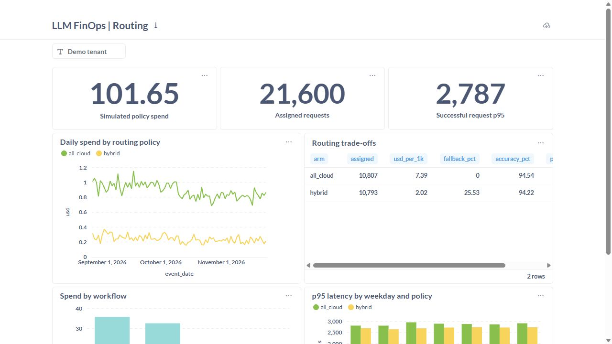
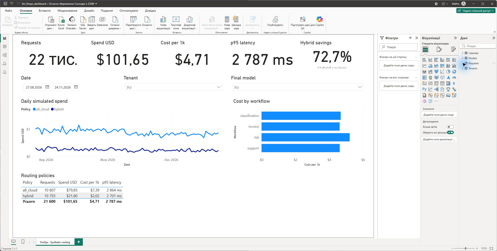

# BI reports

## Metabase

Run the following after building the warehouse.

```powershell
docker compose up -d --wait metabase
uv run --locked --no-sync python -m bi.metabase --public-demo
```

The command creates and tests two Metabase dashboards. The anonymous loopback dashboard shows synthetic policy costs, daily history, per-policy latency, and a tenant filter. The authenticated dashboard shows telemetry and price coverage. On a fresh local instance, the initializer uses the login `finops@example.test` with password `FinOpsLocalDemo!16` unless `FINOPS_METABASE_ADMIN_PASSWORD` is set on first use. Database access uses a dedicated read-only role with access to Gold.



## Power BI and Excel

```powershell
uv run --locked --no-sync python -m bi.export
uv run --locked --no-sync python -m bi.powerbi
```

Open the verified [standalone Power BI report](llm_finops_dashboard.pbix) or its [editable project](powerbi/LLM%20FinOps.pbip) in Power BI Desktop. Click Refresh on first opening a project without its local cache. The star schema contains Requests, Calendar, Tenants, and Models with single-direction relationships.

The generator writes a fresh editable project under `output/powerbi`. Its Power Query embeds synthetic facts so a refresh needs no warehouse or local CSV path. Use `--linked-csv` to build a refreshable project backed by generated CSV files.



The scoped Excel workbook and CSVs are written to `output/bi`. Those files contain warehouse marts, including local source coverage, and are intended for local analysis. [Power BI projects](https://learn.microsoft.com/en-us/power-bi/developer/projects/projects-overview)
